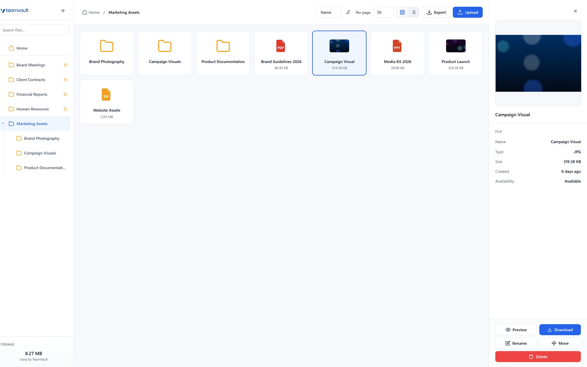
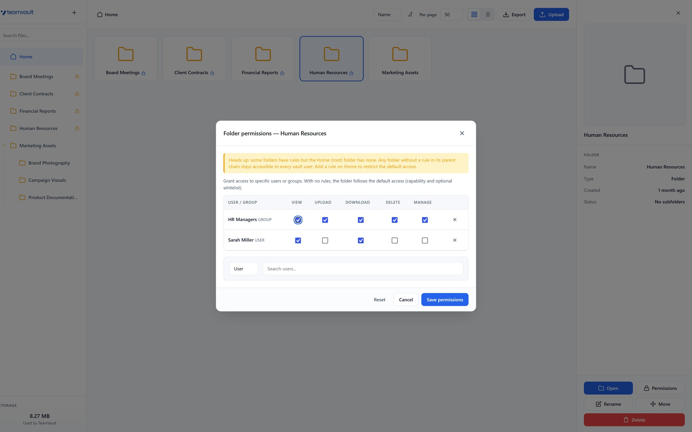
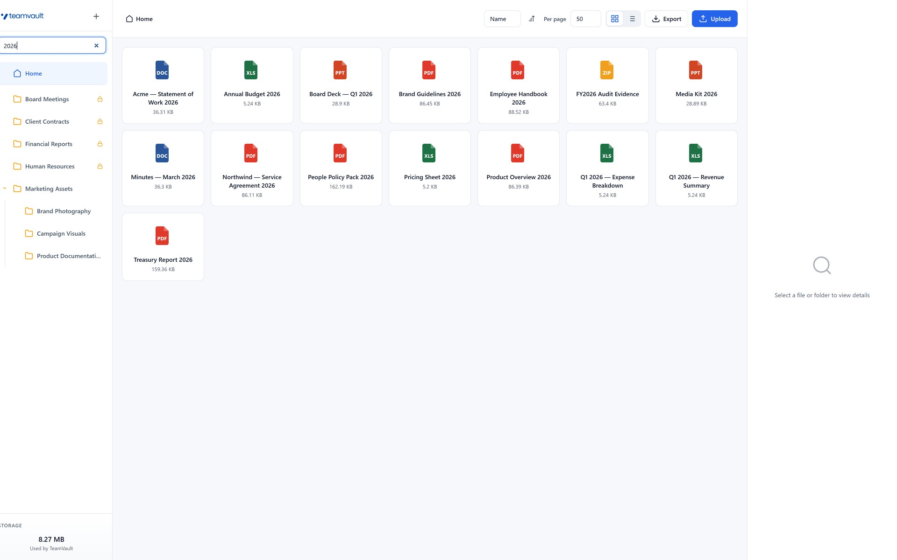
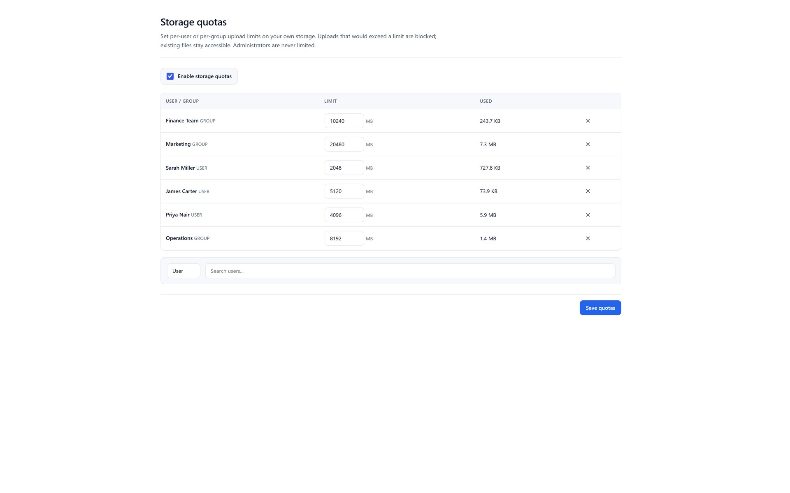
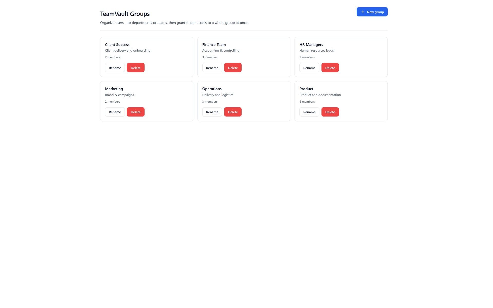
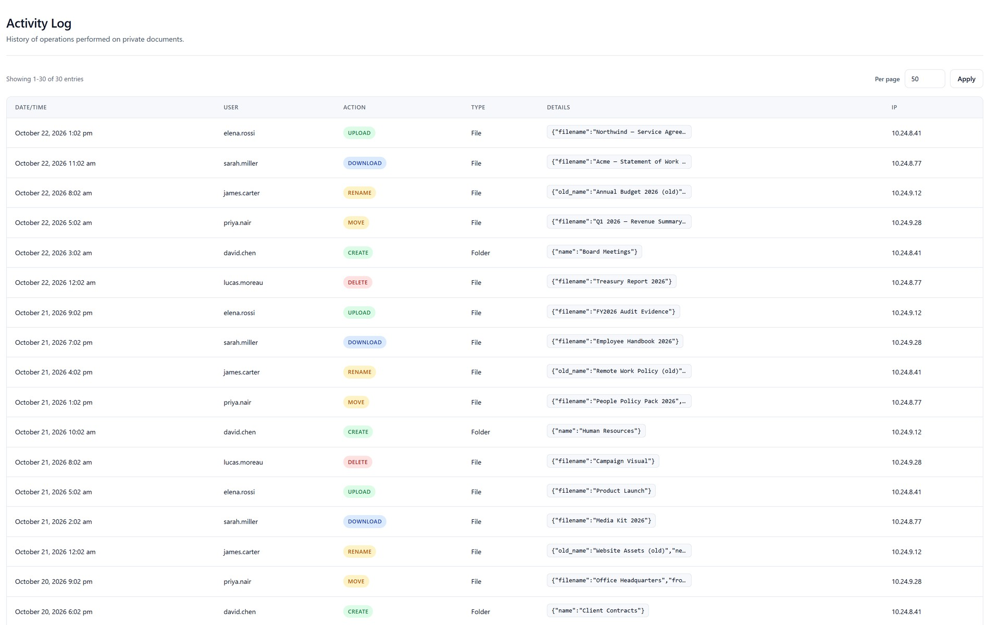
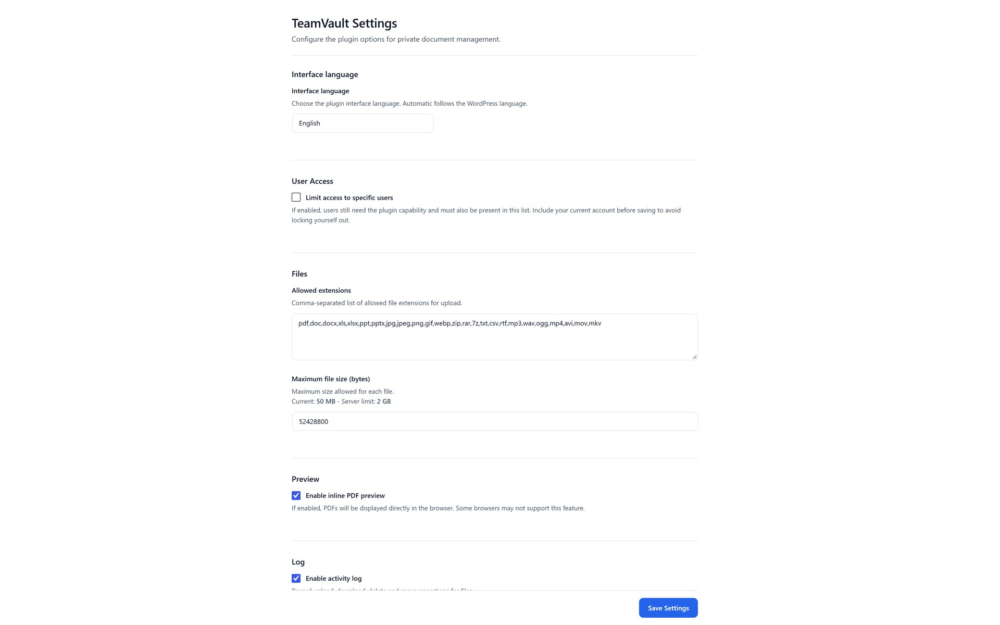

# Mikesoft TeamVault

Private document management for WordPress teams, with protected storage and granular access control

[](https://github.com/TheStreamCode/mikesoft-teamvault/actions/workflows/ci.yml)
[](https://wordpress.org/plugins/mikesoft-teamvault/)
[](LICENSE)


English · [Italiano](README.it.md) · [Français](README.fr.md) · [Español](README.es.md) · [Deutsch](README.de.md)

Mikesoft TeamVault adds a private document workspace inside the WordPress admin for teams, agencies, partners, and back-office operations that need controlled access to shared files. Documents are stored outside the Media Library and delivered through authenticated WordPress handlers instead of public media URLs. This repository is the public source mirror: installations and updates come from [WordPress.org](https://wordpress.org/plugins/mikesoft-teamvault/), and user support runs through the [official support forum](https://wordpress.org/support/plugin/mikesoft-teamvault/).

Mikesoft TeamVault is an independent plugin; it is not affiliated with, sponsored by, or endorsed by WordPress, Automattic, or the WordPress Foundation.



## Install

1. In WordPress admin, go to `Plugins > Add New`.
2. Search for `Mikesoft TeamVault`.
3. Click `Install Now` and activate the plugin.
4. Open `TeamVault > Settings` to review access, storage, and file rules.

Manual alternative: download the release package from [WordPress.org](https://wordpress.org/plugins/mikesoft-teamvault/), upload it to `wp-content/plugins/mikesoft-teamvault/`, and activate it from the Plugins screen.

## Quick start

1. Open `TeamVault > Settings` and review the storage path, allowed extensions, and upload limit.
2. Grant the `manage_private_documents` capability only to the roles or users that need vault access.
3. Create groups when permissions should follow departments or project teams, then create the document folders.
4. Upload a file from the grid or list view and confirm preview and download behavior with a non-administrator account.

## Screenshots

| Per-folder permissions | Search across the vault | Storage quotas |
| :---: | :---: | :---: |
| [](.wordpress-org/assets/screenshot-2.jpg) | [](.wordpress-org/assets/screenshot-3.jpg) | [](.wordpress-org/assets/screenshot-4.jpg) |
| **Groups** | **Activity log** | **Settings** |
| [](.wordpress-org/assets/screenshot-5.jpg) | [](.wordpress-org/assets/screenshot-6.jpg) | [](.wordpress-org/assets/screenshot-7.jpg) |

## Features

- Private storage outside the normal Media Library workflow.
- Capability, optional whitelist, user, group, and per-folder access controls, with inheritance and explicit child overrides.
- Folder operations (create, rename, move, delete) and validated drag-and-drop uploads with inline previews, including PDFs.
- Preview-only access that blocks downloads and ZIP exports.
- Per-user and per-group storage quotas, enforced before upload.
- Access reports, activity logging, CSV export, and folder-aware email notifications for upload, download, delete, and denied-access events.
- ZIP export plus orphan cleanup and storage reindex maintenance tools.
- English, Italian, French, Spanish, and German admin interfaces.

All governance capabilities are included in the free plugin.

## Requirements

- WordPress 6.0 or later.
- PHP 8.0 or later.
- A writable storage path for private documents.
- `ZipArchive` on the server for the export features.

## Configuration

Open `TeamVault > Settings` after activation. The main settings are:

| Setting | Purpose | Default |
| --- | --- | --- |
| Interface language | Follows the WordPress locale or forces a listed language | Automatic |
| User whitelist | Adds an explicit user allowlist on top of the required capability | Disabled |
| Allowed extensions | Restricts uploads to the configured document, image, archive, audio, and video types | Safe built-in list |
| Maximum file size | Applies a plugin upload limit on top of PHP and web-server limits | 50 MB |
| PDF preview | Allows authenticated inline PDF previews | Enabled |
| Activity log | Records document operations for audit and reporting | Enabled |
| Delete data on uninstall | Removes plugin tables, options, capabilities, and marked storage on uninstall | Disabled |

Groups, per-folder permissions, quotas, reports, and notifications have dedicated admin pages. Configure access before inviting non-administrator users.

Runtime configuration is stored in WordPress options; TeamVault does not read settings from environment variables or a repository `.env` file. Keep database credentials and salts in the site-level `wp-config.php`.

## Privacy and security

Private files are never served through public media URLs: downloads and previews pass through authenticated WordPress handlers with private, no-cache responses.

- Vault access uses the `manage_private_documents` capability; new activations grant it to Administrators only.
- Optional whitelist mode adds a second authorization layer for selected users.
- Per-folder permissions limit access to the granted users, groups, and actions, with inheritance from parent folders. Folders without rules keep the capability-based behavior, and Administrators always keep full access.
- Settings, groups, quotas, notifications, reports, logs, whitelist management, maintenance tools, and uninstall data controls require `manage_options`.
- Storage defaults to `wp-content/uploads/private-documents/` and is protected with server-level deny files: the generated `.htaccess` on Apache and LiteSpeed, `web.config` on IIS, and an equivalent Nginx rule that denies direct requests to that path.
- For high-sensitivity deployments, prefer a custom storage path outside the public webroot. The storage widget shows only TeamVault usage.

See [`SECURITY.md`](SECURITY.md) for vulnerability reporting.

## Troubleshooting

### ZIP export fails

The export requires the PHP `ZipArchive` extension and a writable storage path. Enable the extension or ask the hosting provider to enable it, then retry the export.

### An administrator is locked out after enabling the whitelist

Whitelist mode is an allowlist. Keep the current administrator account in the allowed users list before saving settings.

### Files are missing after a site migration

A site migrated without the private storage folder keeps TeamVault records in the database while the original binaries are missing. Copy the storage directory during migrations, then use the cleanup and reindex tools in the settings screen after confirming the copy.

### Uploads are rejected

Check the allowed extensions, the maximum file size, and the PHP upload limits. TeamVault validates the extension, detected MIME type, size, and dangerous content patterns before storing a file, and reports the detected content type on a mismatch.

## Development

Development requires PHP 8.2 or later for PHPUnit 11, Composer 2, Node.js 24 for the JavaScript and Plugin Check tooling, and Git; the plugin itself supports PHP 8.0 or later.

Install the locked development dependencies and run the standard PHP checks:

```bash
composer install --no-interaction --prefer-dist
composer validate --strict
composer audit --locked
composer ci
```

`composer ci` runs PHP lint and the PHPUnit suite. GitHub Actions also runs WordPress Plugin Check against a clean runtime package.

Additional checks:

```bash
node --check assets/js/admin-app-core.js
node --check assets/js/admin-app-governance.js
node --check assets/js/admin-app.js
node --check assets/js/admin-notice-dismiss.js
node --test tests/plugin-check-output.test.mjs
```

There is no asset compilation step: runtime PHP, CSS, and JavaScript are committed as source. `git archive --format=zip --prefix=mikesoft-teamvault/ --output=mikesoft-teamvault.zip HEAD` builds a package from a committed revision using the `.gitattributes` export excludes.

Maintainer and developer notes:

- [`docs/developer/hooks.md`](docs/developer/hooks.md) - hooks and filters
- [`docs/developer/i18n.md`](docs/developer/i18n.md) - translation workflow
- [`docs/maintainer/local-development.md`](docs/maintainer/local-development.md) - local development and manual QA
- [`docs/maintainer/release.md`](docs/maintainer/release.md) - release and WordPress.org deployment
- [`docs/maintainer/security-review.md`](docs/maintainer/security-review.md) - latest security review

## Support

- End-user support: [WordPress.org support forum](https://wordpress.org/support/plugin/mikesoft-teamvault/)
- Email: [teamvault@mikesoft.it](mailto:teamvault@mikesoft.it)
- Website: [mikesoft.it](https://mikesoft.it)
- Security reports: see [`SECURITY.md`](SECURITY.md), never a public issue.

## Contributing

This repository is the public source mirror for the plugin. External pull requests are not accepted; see [`CONTRIBUTING.md`](CONTRIBUTING.md) for the reporting policy and the maintainer workflow.

## License

GPL-2.0-or-later - see [`LICENSE`](LICENSE).

---

Maintained by [Michael Gasperini (Mikesoft)](https://mikesoft.it). If this project is useful to you, consider [sponsoring its maintenance](https://github.com/sponsors/TheStreamCode).
